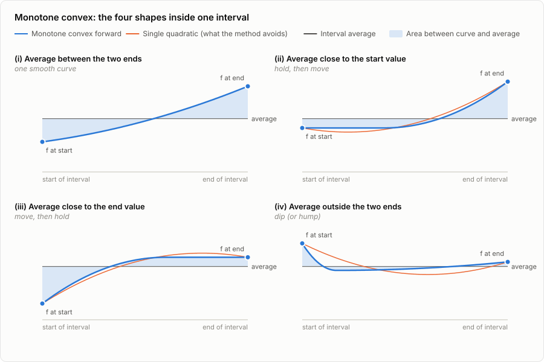
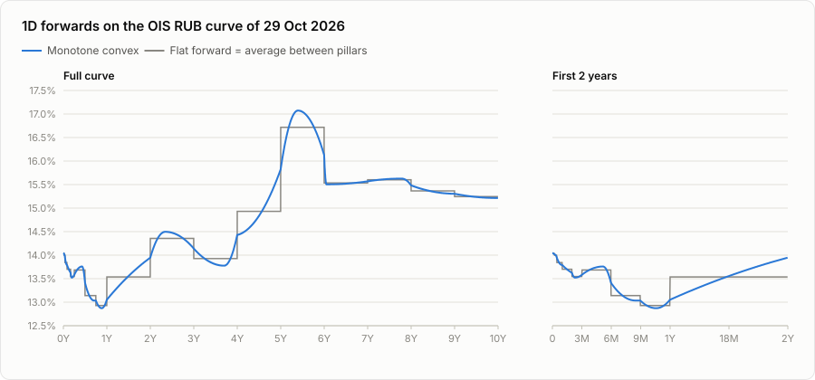

# Monotone convex interpolation of a yield curve

*A plain-language guide with the full maths, based on P. Hagan and G. West, "Interpolation Methods for Curve Construction" (2006).*

**Who this is for.** Anyone who works with rate curves (traders, brokers, analysts, developers) and wants to understand how a forward curve is drawn between the quoted tenors. No maths background is assumed. Every formula is explained in words first, and you can skip the formulas on a first read without losing the thread.

**What you will learn**

- what discount factors, zero rates and forward rates are, and how they relate to each other;
- why drawing a forward curve requires a choice that the market does not make for you;
- how the monotone convex method makes that choice, step by step, with every formula;
- how it behaves on a real RUB OIS curve, and which results tend to surprise people.

Paragraphs marked **Watch out** point at things that are often misunderstood. Derivations are folded away under "Show the derivation", so open them only if you want the algebra.

## Contents

1. [Building blocks](#1-building-blocks)
2. [The interpolation problem](#2-the-interpolation-problem)
3. [Monotone convex, step by step](#3-monotone-convex-step-by-step)
4. [Worked example on a real curve](#4-worked-example-ois-rub-29-oct-2026)
5. [What the method guarantees, and what it doesn't](#5-what-the-method-guarantees-and-what-it-doesnt)
6. [Common misunderstandings](#6-common-misunderstandings)
7. [Using it in dvs-rates-monitor](#7-using-it-in-dvs-rates-monitor)
- [Appendix A. Formula sheet](#appendix-a-formula-sheet)
- [Appendix B. Reference implementation (Python)](#appendix-b-reference-implementation-python)
- [References](#references)

## Notation

| Symbol | Meaning | Example |
|---|---|---|
| $t$ | time from the value date, in years | $t = 0.5$ is six months |
| $t_0 = 0 < t_1 < \dots < t_n$ | **pillars**: the maturities that have market quotes | 1W, 2W, 1M, …, 10Y |
| $P(t)$, $P_i = P(t_i)$ | discount factor: today's value of 1 paid at time $t$ | $P(\text{1Y}) = 0.8749$ |
| $r(t)$ | zero rate, continuously compounded | 13.37% |
| $y(t) = -\ln P(t) = r(t)\,t$ | accumulated rate up to $t$ ("distance travelled", see 1.6) | |
| $f(t)$ | instantaneous forward rate at time $t$ ("speedometer reading") | |
| $h_i = t_i - t_{i-1}$ | length of interval $i$ | |
| $f^d_i$ | **discrete forward**: the *average* forward over interval $i$ | |
| $f_i$ | the forward *exactly at* pillar $t_i$ | |
| $x$ | position *inside* one interval: 0 at its start, 1 at its end | |
| $g(x)$ | forward minus the interval's average | |
| $G(x)$ | $g$ accumulated from the start of the interval up to $x$ | |

Interval $i$ runs from pillar $t_{i-1}$ to pillar $t_i$, so interval 1 runs from today to the first pillar.

In formulas, rates are decimals (0.1337); in the text, they are percentages (13.37%). Unless stated otherwise, all rates in this document are **continuously compounded** (section 1.2 explains why).

---

## 1. Building blocks

### 1.1 The discount factor

A **discount factor** $P(t)$ is the price today of one unit of money paid at time $t$. If $P(\text{1Y}) = 0.8749$, then 1 rouble received in one year is worth 0.8749 roubles today.

Everything else on a rate curve (zero rates, forward rates, par rates) is just a different way of describing discount factors. Two facts are worth keeping in mind:

- $P(0) = 1$, because money today is worth exactly itself;
- when rates are positive, $P(t)$ falls as $t$ grows, because money further away is worth less today.

### 1.2 One discount factor, many rates: compounding conventions

A rate is a way of *expressing* a discount factor. The same discount factor can be written with different conventions:

| Convention | Formula | 1Y example, $P = 0.874891$ |
|---|---|---|
| simple | $P = \dfrac{1}{1 + r_s\,t}$ | $r_s = 14.30\%$ |
| annual compounding | $P = (1 + r_a)^{-t}$ | $r_a = 14.30\%$ |
| continuous compounding | $P = e^{-r_c\,t}$ | $r_c = 13.37\%$ |

All three rates describe the same deal. Over exactly one year, simple and annual compounding coincide; continuous compounding gives a lower number because interest is assumed to be added to the balance continuously.

**Why mathematicians prefer continuous compounding.** Going from today to $t_2$ is the same as going from today to $t_1$ and then from $t_1$ to $t_2$, so discount factors *multiply*: $P(0, t_2) = P(0, t_1) \times P(t_1, t_2)$. With the exponential form, multiplying discount factors turns into *adding* exponents, because $e^{-a} \times e^{-b} = e^{-(a+b)}$. This makes the quantity

$$
y(t) = -\ln P(t) = r(t)\,t
$$

additive over time, like distance travelled. Every formula in this document is built on $y(t)$.

> **Watch out.** 13.37% continuous and 14.30% simple are not two different opinions about the 1-year rate. Only compare rates quoted in the same convention. To convert over a period $t$: $r_c = \ln(1 + r_s t)/t$ and $r_s = (e^{r_c t} - 1)/t$.

### 1.3 The zero rate

The **zero rate** $r(t)$ is the single rate that turns the discount factor into a continuously compounded return:

$$
r(t) = \frac{-\ln P(t)}{t} = \frac{y(t)}{t}
$$

It is the average rate earned from today to $t$ on an investment that pays everything at $t$, with no coupons in between. That is why it's called a *zero-coupon* rate.

### 1.4 Where discount factors come from: par rates and bootstrapping

The market does not quote discount factors. It quotes **par swap rates**: the fixed rate at which a swap is worth zero.

- **Up to 1Y,** an OIS has a single payment at maturity, so $P = 1/(1 + r\,t)$ with $r$ the quoted rate.
- **Beyond 1Y,** the fixed leg pays annual coupons. At the par rate the fixed leg is worth the same as the floating leg, and a floating leg (plus the notional) is worth 1. So for a swap maturing at pillar $N$:

$$
r_N \sum_{k=1}^{N} \delta_k P_k + P_N = 1
$$

Here $\delta_k$ is the length in years of coupon period $k$. Knowing $P_1, \dots, P_{N-1}$ from the shorter swaps, this equation gives $P_N$. Repeating the process tenor by tenor is called **bootstrapping**.

After bootstrapping, the discount factor is known **exactly at the pillars and nowhere else**. Everything between pillars is interpolation, which is the subject of this document.

> **Watch out.** Par rate, zero rate and forward rate are three different numbers for "the 5-year point". On the 29 Oct 2026 RUB OIS curve: the 5Y par rate is 14.94% (simple, annual coupons), the 5Y zero rate is 14.02% (continuous), and the 5Y→6Y forward is 16.71% (continuous). None of them is wrong; they answer different questions.

### 1.5 Forward rates and the no-arbitrage argument

**Question:** what interest rate can I lock in *today* for the period between two future dates $t_1$ and $t_2$?

There are two ways to invest from today until $t_2$:

1. invest directly until $t_2$;
2. invest until $t_1$, then reinvest from $t_1$ to $t_2$ at a rate $F$ agreed today.

If these two gave different results, you could borrow one way and lend the other way, and make a riskless profit (an **arbitrage**). In a functioning market this can't last, so the two routes must give the same result:

$$
P(t_2) = P(t_1)\, e^{-F\,(t_2 - t_1)}
\quad\Longrightarrow\quad
F = \frac{\ln P(t_1) - \ln P(t_2)}{t_2 - t_1} = \frac{y(t_2) - y(t_1)}{t_2 - t_1}
$$

**Example (29 Oct 2026 curve).** $P(\text{1Y}) = 0.874891$, $P(\text{2Y}) = 0.764098$, and $t_2 - t_1 = 1.000472$ years. Then $F = \ln(0.874891 / 0.764098) / 1.000472 = 13.53\%$. That's the rate for the second year implied by today's prices.

### 1.6 The instantaneous forward rate: the speedometer

Shrink the period $[t_1, t_2]$ to an instant and you get the **instantaneous forward rate** $f(t)$, the rate "for the moment $t$". In maths, this is the slope (derivative) of the accumulated rate:

$$
f(t) = \frac{d\,y(t)}{dt} = -\frac{d \ln P(t)}{dt}
$$

Going the other way, accumulating (integrating) the forward gives back everything else:

$$
y(t) = \int_0^t f(s)\,ds, \qquad P(t) = e^{-\int_0^t f(s)\,ds}, \qquad r(t) = \frac{1}{t}\int_0^t f(s)\,ds
$$

The last formula says that **the zero rate is the average of the forward rates** between today and $t$.

A car journey is a helpful picture, and this document returns to it often:

| Car journey | Rate curve |
|---|---|
| distance travelled since the start | $y(t) = -\ln P(t) = r(t)\,t$ |
| average speed since the start | zero rate $r(t)$ |
| speedometer reading at a moment | instantaneous forward $f(t)$ |
| average speed between two checkpoints | discrete forward $f^d_i$ |
| checkpoints where the odometer was read | pillars, where $P$ is known |

One identity explains why forward curves are so sensitive:

$$
f(t) = r(t) + t\,r'(t)
$$

In words: the speedometer reading equals the average speed so far, plus the elapsed time multiplied by how fast that average is changing. The factor $t$ amplifies small things. At 10 years, misjudging the slope of the zero curve by just 1bp per year moves the forward by 10bp.

<details>
<summary>Show the derivation</summary>

Since $y(t) = r(t)\,t$, the product rule gives $f(t) = y'(t) = r(t) + t\,r'(t)$.
</details>

### 1.7 The 1-day (overnight) forward

For a chart, we use the forward for one day, from date $k$ to date $k+1$, with simple compounding, which is the same convention as RUONIA:

$$
F_k = \frac{P(t_k)/P(t_{k+1}) - 1}{t_{k+1} - t_k} = \frac{e^{\,y(t_{k+1}) - y(t_k)} - 1}{t_{k+1} - t_k}
$$

It differs from the continuous instantaneous forward by about $f^2 \Delta t / 2$. That's about 0.3bp at 14%: invisible on a chart, but worth knowing if you compare numbers to the last decimal.

### 1.8 Forward rates are not forecasts

The **expectations hypothesis** says the forward rate equals the expected future rate. In practice, a forward contains the expected rate **plus a term premium**, which is compensation for the risk of committing money for longer (plus small technical effects). At the short end of a RUB curve, forwards mostly reflect expectations of the CBR key rate. A few years out, the premium matters. So a forward curve is best read as "what is priced in", not "what the market predicts".

---

## 2. The interpolation problem

### 2.1 What the market tells us, and what it doesn't

Knowing the discount factors at the pillars is like knowing the odometer reading at each checkpoint. That tells you the **average speed between consecutive checkpoints**, the discrete forwards $f^d_i$, and **nothing about how the speed varied in between**. A car averaging 60 km/h between two checkpoints may have driven at a steady 60, or at 40 and then 80.

So infinitely many forward curves are consistent with the same quotes. **Interpolation is the choice of one of them.** It adds no market information; it is a modelling decision.

> **Watch out.** Every sensible method reproduces the same averages between pillars, so all of them price the input swaps correctly. Methods differ **only inside the intervals**. If two forward curves disagree between two pillars, neither is "the market's view"; they are two ways of spreading the same average.

### 2.2 *What* you interpolate decides the forward curve

"Linear interpolation" means different things depending on which quantity you draw straight lines through. Because the forward is the *slope* of $y(t)$, each choice produces a very different forward curve:

| Method | What is interpolated | What the forward curve looks like |
|---|---|---|
| Linear on zero rates | $r(t)$ by straight lines | **Sawtooth.** $r'(t)$ changes abruptly at each pillar, so $f = r + t\,r'$ jumps there |
| Linear on $\ln P$ (Hagan & West call it "raw interpolation") | $y(t)$ by straight lines | **Steps.** Flat at the average inside each interval, jumping at pillars |
| Cubic spline on $r(t)$ or $y(t)$ | a smooth curve through all points at once | **Smooth but wavy.** Can overshoot, and changing one quote moves the whole curve |
| **Monotone convex** | the forward $f(t)$ itself, built interval by interval | **Continuous, local, no invented waves** |

In tests on a stored RUB OIS curve: linear on zero rates produced jumps of up to 89bp at pillars. With natural cubic splines, moving only the 5Y quote by 5bp shifted forwards *before 3Y* by 4–7bp.

### 2.3 What makes a method good: Hagan & West's checklist

Hagan and West judge interpolation methods by questions like these:

1. **Are the forwards positive?** When all the averages are positive (as in any RUB curve), a negative forward somewhere is an artefact of the method, not of the market.
2. **Are the forwards continuous?** Nothing special happens to the overnight rate on a pillar date, so the forward curve should not jump there.
3. **Is the method local?** Changing one quote should change the curve only near that quote.
4. **Are the forwards stable?** A small change in an input should produce a bounded, comparably small change in the forwards.
5. **Are hedges local?** The risk of a 4Y trade should sit mostly in the 3Y–5Y quotes, not spread across the whole curve. This follows from locality.

Each classic method fails at least one of these. Linear on $\ln P$ fails continuity; splines fail locality and can fail positivity. The monotone convex method was designed to do well on all five.

---

## 3. Monotone convex, step by step

**The idea in one paragraph.** The averages between pillars are known. First, estimate what the forward should be *exactly at each pillar* (steps 2–3). Then, inside each interval, draw a curve that starts at the left pillar's value, ends at the right pillar's value, and keeps the interval's average exactly. Choose the simplest such curve, but never let it wiggle in ways the data don't ask for (steps 4–5). Finally, accumulate the forwards to get discount factors and daily forwards back (steps 6–7).



*Figure 1. The four shapes inside one interval. Blue: the monotone convex forward. Orange: the single quadratic the method avoids in cases (ii)–(iv). The shaded area between the curve and the average is equally large above and below the line, which is what keeps the average.*

### Step 1: the averages (discrete forwards)

For each interval, compute the average forward from the bootstrapped discount factors, exactly as in section 1.5:

$$
f^d_i = \frac{y_i - y_{i-1}}{t_i - t_{i-1}} = \frac{r_i t_i - r_{i-1} t_{i-1}}{t_i - t_{i-1}}, \qquad y_0 = 0
$$

### Step 2: the forward at each pillar

**Rule in words:** place each interval's average at the *middle* of its interval, draw a straight line between the two neighbouring midpoints, and read off its value at the pillar between them.

$$
f_i = \frac{h_i}{h_i + h_{i+1}}\, f^d_{i+1} + \frac{h_{i+1}}{h_i + h_{i+1}}\, f^d_i, \qquad i = 1, \dots, n-1
$$

> **Watch out: the weights look swapped.** Each average is weighted by the length of the *other* interval, so the **shorter** neighbouring interval gets the **bigger** weight. This is intentional. A short interval's average is taken over times that are all close to the pillar, so it says more about the forward at the pillar than the average of a long interval, most of which lies far away.
>
> Example at 1Y: the left interval 9M–1Y is 0.25 years long with an average of 12.93%, and the right interval 1Y–2Y is 1.0 year long with an average of 13.53%. So $f(\text{1Y}) = 0.80 \times 12.93\% + 0.20 \times 13.53\% = 13.05\%$, close to the short interval's average.

<details>
<summary>Show why "midpoints and a straight line" gives this formula</summary>

The left midpoint is at $t_i - h_i/2$ with value $f^d_i$; the right midpoint is at $t_i + h_{i+1}/2$ with value $f^d_{i+1}$. They are $(h_i + h_{i+1})/2$ apart, and the pillar sits $h_i/2$ to the right of the left midpoint. Linear interpolation therefore puts weight $\frac{h_i/2}{(h_i + h_{i+1})/2} = \frac{h_i}{h_i + h_{i+1}}$ on $f^d_{i+1}$, and the rest on $f^d_i$.
</details>

**The two ends.** The first and last pillars have a neighbour on one side only, so Hagan and West use:

$$
f_0 = f^d_1 - \tfrac{1}{2}\left(f_1 - f^d_1\right), \qquad f_n = f^d_n - \tfrac{1}{2}\left(f_{n-1} - f^d_n\right)
$$

In words: this makes the forward curve **start flat** at $t = 0$ and **end flat** at the last pillar (zero slope at both ends). Step 4 shows why.

### Step 3: the positivity collar

Hagan and West add one amendment that keeps forwards positive. Each pillar forward is clipped into a range:

$$
0 \le f_0 \le 2 f^d_1, \qquad 0 \le f_i \le 2 \min\!\left(f^d_i,\ f^d_{i+1}\right), \qquad 0 \le f_n \le 2 f^d_n
$$

**Why "2 times the average"?** If a pillar forward were more than twice an adjacent interval's average, the curve inside that interval would have to dive below zero somewhere to bring the average back down. The cap prevents this, so the curve never goes below zero.

On RUB curves, with forwards at 13–17%, the collar never binds; it changed nothing on the 29 Oct 2026 curve. It matters in low or negative rate markets. Where negative rates are legitimate (EUR or JPY in the past), people drop the lower bound of 0.

### Step 4: the curve inside one interval

Zoom into interval $i$, from $t_{i-1}$ to $t_i$. To keep formulas simple, measure position as a fraction of the interval:

$$
x = \frac{t - t_{i-1}}{h_i}, \qquad 0 \le x \le 1
$$

and write the forward as **the average plus a deviation** $g$:

$$
f(t) = f^d_i + g(x)
$$

The deviation must satisfy three requirements:

1. $g(0) = g_0 = f_{i-1} - f^d_i$, so the curve **starts at the left pillar's value**;
2. $g(1) = g_1 = f_i - f^d_i$, so it **ends at the right pillar's value**;
3. $\int_0^1 g(x)\,dx = 0$, so it **keeps the interval average**. Geometrically, the area above the average line equals the area below it (the shaded areas in Figure 1). This is what makes the curve reprice the input discount factors exactly.

> **Watch out.** $g_0$ and $g_1$ are *not* the forwards at the pillars. They are how far each pillar forward sits **from this interval's average**: positive if above it, negative if below. The whole method is driven by these two numbers.

The simplest curve that can meet three requirements has three free numbers: a **quadratic** $g(x) = a + bx + cx^2$. Solving the three requirements gives

$$
g(x) = g_0\,(1 - 4x + 3x^2) + g_1\,(3x^2 - 2x)
$$

<details>
<summary>Show the derivation</summary>

From $g(0) = g_0$: $a = g_0$.
From $g(1) = g_1$: $g_0 + b + c = g_1$.
From the area condition: $g_0 + b/2 + c/3 = 0$.

The second equation gives $b = g_1 - g_0 - c$. Substituting into the third: $g_0 + (g_1 - g_0 - c)/2 + c/3 = 0$, so $(g_0 + g_1)/2 = c/6$, that is $c = 3(g_0 + g_1)$, and then $b = -4g_0 - 2g_1$.
So $g(x) = g_0 - (4g_0 + 2g_1)\,x + 3(g_0 + g_1)\,x^2$. Collecting the $g_0$ and $g_1$ terms gives the formula above.
</details>

**Why the curve starts and ends flat.** The end rule of step 2 gives $g_0 = -g_1/2$ in the first interval. Plugged into the quadratic, the slope at $x = 0$ becomes $-4g_0 - 2g_1 = 0$. The same happens at the last pillar.

### Step 5: when the simple curve misbehaves, four cases

The quadratic works well when the average lies **between** the two pillar values and not too close to either of them. Otherwise it **overshoots**: it first moves the wrong way, or travels past the end value and then comes back (the orange curves in Figure 1). That is a wave the data never asked for.

Hagan and West therefore split all possible combinations of $(g_0, g_1)$ into four cases, which they call *sectors*:

| Case | In words | Condition | Shape used |
|---|---|---|---|
| **(i)** | the average lies between the two pillar values, at a comfortable distance from both | opposite signs, and $\tfrac12 \lvert g_0\rvert \le \lvert g_1\rvert \le 2\lvert g_0\rvert$ | the single quadratic |
| **(ii)** | the average lies between them, **much closer to the start** value | opposite signs, and $\lvert g_1\rvert > 2\lvert g_0\rvert$ | **hold** the start value, then move to the end value |
| **(iii)** | the average lies between them, **much closer to the end** value | opposite signs, and $\lvert g_1\rvert < \tfrac12\lvert g_0\rvert$ | **move** to the end value, then **hold** it |
| **(iv)** | the average lies **above both** pillar values or **below both** | same sign: $g_0\,g_1 \ge 0$ | a **dip** or **hump**: two quadratic halves meeting at an extreme $A$ |

("Opposite signs" means one pillar value is above the average and the other below it.) If $g_0 = g_1 = 0$, the curve is simply flat at the average.

The formulas use a **switch point** $\eta$ (eta), a position between 0 and 1 inside the interval where the shape changes:

**Case (i)**, the single quadratic:

$$
g(x) = g_0\,(1 - 4x + 3x^2) + g_1\,(3x^2 - 2x)
$$

**Case (ii)**, hold then move:

$$
\eta = \frac{g_1 + 2g_0}{g_1 - g_0}, \qquad
g(x) = \begin{cases}
g_0, & x \le \eta \\[4pt]
g_0 + (g_1 - g_0)\left(\dfrac{x - \eta}{1 - \eta}\right)^{2}, & x > \eta
\end{cases}
$$

**Case (iii)**, move then hold:

$$
\eta = \frac{3g_1}{g_1 - g_0}, \qquad
g(x) = \begin{cases}
g_1 + (g_0 - g_1)\left(\dfrac{\eta - x}{\eta}\right)^{2}, & x < \eta \\[4pt]
g_1, & x \ge \eta
\end{cases}
$$

**Case (iv)**, dip or hump:

$$
\eta = \frac{g_1}{g_0 + g_1}, \qquad A = -\frac{g_0\,g_1}{g_0 + g_1}, \qquad
g(x) = \begin{cases}
A + (g_0 - A)\left(\dfrac{\eta - x}{\eta}\right)^{2}, & x \le \eta \\[4pt]
A + (g_1 - A)\left(\dfrac{x - \eta}{1 - \eta}\right)^{2}, & x > \eta
\end{cases}
$$

How to read these:

- In cases (ii) and (iii), $\eta$ is not a free choice. It is the unique switch point that keeps the area condition, so the interval average still holds.
- In case (iv), the extreme (the bottom of the dip or the top of the hump) is at $x = \eta$, and $A$ is how far it sits from the average. Its size is never larger than that of the pillar value closer to the average, $\lvert A\rvert \le \min(\lvert g_0\rvert, \lvert g_1\rvert)$, so the dip is no deeper than necessary. In Figure 1 (case iv), the single quadratic dips about twice as deep.
- All four formulas start at $g_0$, end at $g_1$, and have zero area. They also **join up at the borders between cases**: on a border, the neighbouring formulas produce the same curve. So a small change in a quote never makes the shape jump.

> **Watch out: the dip or hump in case (iv) is not a bug.** If an interval's average is above both pillar values, the forward *must* rise above the average somewhere inside the interval, or the average could not be that high. Every continuous method produces a hump there. Monotone convex just keeps it as small as the data allow.

**Where the name comes from.** Two shape guarantees follow from these cases:

- **Monotone:** if the averages rise across three consecutive intervals, the middle interval is in case (i), (ii) or (iii), and its forward never turns down inside it (it may hold flat for a while). The same holds for falling averages. Nothing turns around unless the averages turn around.
- **Convex or concave:** inside each interval, the curve bends in one direction only. There is no S-shaped wiggle within a single interval.

<details>
<summary>Show where the case boundaries come from</summary>

The quadratic's slope is $g'(x) = g_0(6x - 4) + g_1(6x - 2)$, which changes linearly with $x$. So the quadratic is monotone on $[0,1]$ exactly when the slopes at both ends have the same sign. The slopes are $g'(0) = -4g_0 - 2g_1$ and $g'(1) = 2g_0 + 4g_1$. For $g_0 < 0 < g_1$, both are non-negative exactly when $-g_0/2 \le g_1 \le -2g_0$, which is case (i). Beyond the upper edge, $g'(0) < 0$ and the curve first dips below its start value: case (ii). Below the lower edge, $g'(1) < 0$ and the curve overshoots its end value: case (iii). When $g_0$ and $g_1$ have the same sign, no monotone curve can keep the average, which is case (iv).
</details>

### Step 6: back to discount factors and zero rates

To get discount factors between pillars, accumulate the forward (the "distance travelled"). Inside interval $i$:

$$
y(t) = y_{i-1} + h_i \left( f^d_i\,x + G(x) \right), \qquad G(x) = \int_0^x g(s)\,ds
$$

$$
P(t) = e^{-y(t)}, \qquad r(t) = \frac{y(t)}{t}
$$

The accumulated deviation $G(x)$ has a closed form in each case:

| Case | $G(x)$ |
|---|---|
| (i) | $g_0\,(x - 2x^2 + x^3) + g_1\,(x^3 - x^2)$ |
| (ii) | $g_0\,x$ for $x \le \eta$; &nbsp; $g_0\,x + \dfrac{(g_1 - g_0)(x - \eta)^3}{3(1 - \eta)^2}$ for $x > \eta$ |
| (iii) | $g_1\,x + \dfrac{g_0 - g_1}{3}\left(\eta - \dfrac{(\eta - x)^3}{\eta^2}\right)$ for $x < \eta$; &nbsp; $\dfrac{(2g_1 + g_0)\,\eta}{3} + g_1\,(x - \eta)$ for $x \ge \eta$ |
| (iv) | $A\,x + \dfrac{g_0 - A}{3}\left(\eta - \dfrac{(\eta - x)^3}{\eta^2}\right)$ for $x \le \eta$; &nbsp; $\dfrac{(2A + g_0)\,\eta}{3} + A\,(x - \eta) + \dfrac{(g_1 - A)(x - \eta)^3}{3(1 - \eta)^2}$ for $x > \eta$ |

At the end of every interval $G(1) = 0$, because the area condition holds. So $y(t_i) = y_i$ exactly: **the curve reproduces every input discount factor**.

### Step 7: daily forwards for a chart

1. Build a grid of calendar days from the value date to the last pillar date.
2. For each day, compute $t_k$ **with the same day count used for the pillars**.
3. Compute $y(t_k)$ with step 6.
4. Compute the 1-day forward with section 1.7: $F_k = \left(e^{\,y(t_{k+1}) - y(t_k)} - 1\right) / (t_{k+1} - t_k)$.

> **Watch out: day counts must match.** If the grid measures time differently from the bootstrap (for example ACT/365 on the grid but ACT/ACT on the pillars), pillar dates no longer land exactly on the pillar times, and the chart shows small artificial blips at every pillar.

You could also evaluate $f^d_i + g(x)$ directly at each day instead of going through $y$. The difference is well under 1bp; going through $y$ keeps the chart exactly consistent with the discount factors.

---

## 4. Worked example: OIS RUB, 29 Oct 2026

The OIS RUB curve stored at 10:17 on 29 Oct 2026 (value date 30 Oct 2026), bootstrapped to continuously compounded discount factors. All rates below are continuous.

| Interval | Average $f^d_i$ | Pillar forward at start | Pillar forward at end | Case |
|---|---:|---:|---:|---|
| 0–1W | 14.03% | 14.04% | 14.01% | (i), first interval: starts flat¹ |
| 1W–2W | 13.99% | 14.01% | 13.95% | (ii) hold, then move |
| 2W–1M | 13.84% | 13.95% | 13.79% | (iii) move, then hold |
| 1M–2M | 13.70% | 13.79% | 13.62% | (i) |
| 2M–3M | 13.54% | 13.62% | 13.58% | (iv) dip |
| 3M–6M | 13.68% | 13.58% | 13.41% | (iv) hump |
| 6M–9M | 13.14% | 13.41% | 13.03% | (iii) move, then hold |
| 9M–1Y | 12.93% | 13.03% | 13.05% | (iv) dip |
| 1Y–2Y | 13.53% | 13.05% | 13.94% | (i) |
| 2Y–3Y | 14.35% | 13.94% | 14.14% | (iv) hump |
| 3Y–4Y | 13.92% | 14.14% | 14.43% | (iv) dip |
| 4Y–5Y | 14.93% | 14.43% | 15.82% | (i) |
| 5Y–6Y | 16.71% | 15.82% | 16.12% | (iv) hump |
| 6Y–7Y | 15.53% | 16.12% | 15.57% | (iv) dip |
| 7Y–8Y | 15.60% | 15.57% | 15.48% | (iv) hump |
| 8Y–9Y | 15.36% | 15.48% | 15.30% | (i) |
| 9Y–10Y | 15.24% | 15.30% | 15.21% | (i), last interval: ends flat |

¹ Exactly on the border between cases (i) and (ii); both formulas give the same curve there.

Eight of the 17 intervals are in case (iv). That is not the method's doing: the averages themselves zigzag (for example 14.35% → 13.92% → 14.93% across 2Y–5Y), and every zigzag forces a hump or a dip.

**Example A: 1Y–2Y, case (i).** The average is 13.53%. The pillar forwards are 13.05% at 1Y (step 2 example) and 13.94% at 2Y, so $g_0 = 13.05 - 13.53 = -0.48$ and $g_1 = 13.94 - 13.53 = +0.41$ (in percentage points). The signs are opposite, and $0.24 \le 0.41 \le 0.97$, so this is case (i). At the middle of the interval ($x = 0.5$) the quadratic gives $g = -\tfrac14(g_0 + g_1) = +0.02$, so the forward is 13.55%. The curve rises smoothly from 13.05% to 13.94% through the whole year, sitting below the average early and above it late, with equal areas.

**Example B: 3M–6M, case (iv) hump.** The average is 13.68%, but both pillar forwards are lower: 13.58% at 3M and 13.41% at 6M. So $g_0 = -0.10$ and $g_1 = -0.27$, both negative. The curve must rise above 13.68% somewhere. The formulas give $\eta = 0.73$ and $A = +0.07$, so the hump peaks at 13.76% around early April 2027, then falls to 13.41% at 6M.

**Example C: 6M–9M, case (iii).** The average is 13.14%. The start value 13.41% is far above it, and the end value 13.03% is close below it ($g_0 = +0.27$, $g_1 = -0.11$, and $0.11 < \tfrac12 \times 0.27$). The forward falls from 13.41% to 13.03% by $\eta = 0.83$, around 8.5 months, then holds at 13.03% until 9M.

**Example D: 1W–2W, case (ii).** The average 13.99% is very close to the start value 14.01%. The forward holds 14.01% for the first 11% of the interval (under one day), then falls to 13.95%. In very short intervals, the case distinction is invisible on a chart.



*Figure 2. Daily 1-day forwards from monotone convex (blue) against the interval averages (gray steps), on the 29 Oct 2026 curve.*

Two things in Figure 2 are worth a closer look:

- **The hump at 5Y–6Y.** The average for 5Y–6Y is 16.71%, well above both pillar forwards (15.82% and 16.12%). This comes from the quotes: the 5Y→6Y par step (+36bp) is much larger than its neighbours (+20bp and +13bp), and forwards magnify par differences. The curve peaks at 17.07% around 5.4Y. Any continuous method would show a hump here.
- **The steep fall just after 6Y.** The 6Y pillar forward is 16.12%, while the next interval averages 15.53% and its far end is 15.57%. That is case (iv) with $\eta = 0.05$: the forward drops 62bp in about 19 days, then stays nearly flat. The curve is continuous but not gentle. Continuity guarantees no jumps; it does not guarantee small slopes.

---

## 5. What the method guarantees, and what it doesn't

**Guaranteed**

- **Exact repricing.** Every input discount factor is reproduced, so every input swap is priced at par.
- **Continuous forwards.** No jumps at pillars: both intervals around a pillar use the same pillar value $f_i$.
- **Locality.** The curve inside interval $i$ depends only on the discount factors at four pillars: $t_{i-2}, t_{i-1}, t_i, t_{i+1}$. Changing one discount factor changes the curve in at most four intervals. In a test, moving the 5Y quote left everything before 3Y untouched.
- **Positive forwards**, with the collar of step 3, whenever the averages are positive.
- **No invented waves.** The forward is monotone wherever the averages are, and bends one way only inside each interval.
- **No sudden shape changes.** The four cases join up at their borders.

**Not guaranteed**

- **A smooth slope at pillars.** The forward is continuous, but its slope can change abruptly at a pillar (a kink). Mathematicians call this "continuous but not differentiable".
- **Gentle moves.** As the 6Y example shows, the forward can move fast over a short distance when a pillar value is far from the next average.
- **Removing bumps that come from the quotes.** The method must keep every average, so a strange quote shows up as a strange hump.
- **Anything beyond the last pillar.** The method interpolates; it does not extrapolate.
- **Forecasts.** The forwards include term premium (section 1.8).

---

## 6. Common misunderstandings

**"The curve between pillars is the market's view."**
No. The market fixes only the *average* forward between pillars. The shape inside an interval is the method's choice (section 2.1).

**"A smoother curve is a more accurate curve."**
No. Smoothness is a preference, not information. A cubic spline is smoother than monotone convex in the mathematical sense, yet it invents waves and spreads every quote change across the whole curve.

**"Monotone convex removes noise from the quotes."**
No. It must keep every average, so noisy quotes give noisy forwards. Removing noise needs a *fitting* method that does not reprice the quotes exactly (for example Nelson–Siegel–Svensson, which central banks use for bond curves). That is a different tool for a different job.

**"Linear interpolation is linear interpolation."**
Linear in *what* matters enormously. Linear in zero rates gives sawtooth forwards; linear in $\ln P$ gives step forwards (section 2.2).

**"$f$, $f_i$ and $f^d_i$ are the same thing."**
They are three different objects. $f(t)$ is the forward at any moment, $f_i$ is the forward exactly at pillar $i$ (an *estimate*, step 2), and $f^d_i$ is the *average* over interval $i$ (exact, from quotes, step 1).

**"$g_0$ is the forward at the start of the interval."**
No. $g_0$ is the forward at the start *minus the interval's average*. A negative $g_0$ means the pillar forward is below this interval's average, not that anything is negative.

**"$x$ is time in years."**
No. $x$ is the position inside one interval, from 0 at its start to 1 at its end. Halfway through the 1Y–2Y interval, $x = 0.5$; halfway through 1W–2W, $x$ is also 0.5.

**"Different numbers for the same maturity mean something is wrong."**
Par rate, zero rate and forward rate answer different questions, and each can be quoted with simple, annual or continuous compounding (sections 1.2 and 1.4).

**"The hump (or dip) is a bug."**
In case (iv) it is forced by the data: an average above both pillar values cannot be reached without rising above it (step 5).

**"Locality means nothing else moves when I change one quote."**
The *interpolation* is local. But the *bootstrap* passes a long-end quote change slightly into later discount factors, because later swaps' coupons are discounted with it. So moving the 5Y quote changes the forwards from 3Y to 7Y (most of all 4Y–6Y), and the intervals after 7Y a little.

**"The forward should step on CBR meeting days, so the method is wrong."**
The method doesn't know when meetings happen. It places structure only where pillars are. A meeting-by-meeting view of the key rate needs a different model, with step forwards at meeting dates fitted to the short-end quotes.

**"Why does the curve start and end flat?"**
Because of the end rule in step 2. It is a convention for the edges, where there is no outer neighbour to estimate the pillar forward from.

**"Can I read the 12Y forward from a 10Y curve?"**
No. The method is defined only between the first and last pillars.

**"The 1D forward for tomorrow should equal today's RUONIA fixing."**
Not necessarily. The first interval's shape is a modelling choice (it starts flat at roughly the 0–1W average), and forwards include premium and technical effects. Tomorrow's forward is close to, but not the same as, the latest fixing.

---

## 7. Using it in dvs-rates-monitor

> Status: researched and prototyped; not yet part of the codebase.

- **Input.** The zero curve from `curves.bootstrap_to_zero_curve`. Its `Term` column is the time in years from the value date (ACT/ACT ISDA), and its `Rate` column is the continuously compounded zero rate in percent. So the knots are $x = [0, \text{Term}_1, \dots]$ and $y = [0, \text{Rate}_1/100 \times \text{Term}_1, \dots]$, which is exactly $-\ln P$.
- **Grid.** Calendar days from the value date to the last pillar date, with $t$ computed by `daycounts.actual_actual_isda(value_date, date)`. That is the same day count as `Term`, so pillar dates fall exactly on the knots.
- **Output.** A table of date, term and 1D forward. It is fully determined by the zero curve, so it doesn't need to be stored, and the existing `Curve` class (built around tenor labels such as 3M or 5Y) isn't a natural container for a daily series.
- **Display.** Don't pass the daily forwards through `cubic_spline` for smoothing. They are already dense, and smoothing would reintroduce the waves this method avoids.

---

## Appendix A. Formula sheet

**Inputs:** pillars $0 = t_0 < t_1 < \dots < t_n$ and $y_i = -\ln P(t_i) = r_i t_i$, with $y_0 = 0$.

1. Interval lengths and averages: $h_i = t_i - t_{i-1}$, and $f^d_i = (y_i - y_{i-1})/h_i$ for $i = 1, \dots, n$.
2. Pillar forwards:
   - inside: $f_i = \dfrac{h_i f^d_{i+1} + h_{i+1} f^d_i}{h_i + h_{i+1}}$ for $i = 1, \dots, n-1$;
   - ends: $f_0 = f^d_1 - \tfrac12(f_1 - f^d_1)$ and $f_n = f^d_n - \tfrac12(f_{n-1} - f^d_n)$.
3. Collar: $f_0 \in [0, 2f^d_1]$, $f_i \in [0, 2\min(f^d_i, f^d_{i+1})]$, and $f_n \in [0, 2f^d_n]$.
4. For $t$ in interval $i$: $x = (t - t_{i-1})/h_i$, $g_0 = f_{i-1} - f^d_i$, $g_1 = f_i - f^d_i$.
5. Case:
   - (i) if $g_0 < 0$ and $-g_0/2 \le g_1 \le -2g_0$, or $g_0 > 0$ and $-g_0/2 \ge g_1 \ge -2g_0$;
   - (ii) if $g_0 < 0$ and $g_1 > -2g_0$, or $g_0 > 0$ and $g_1 < -2g_0$;
   - (iii) if $g_0 > 0$ and $0 > g_1 > -g_0/2$, or $g_0 < 0$ and $0 < g_1 < -g_0/2$;
   - (iv) otherwise ($g_0\,g_1 \ge 0$).
6. Forward: $f(t) = f^d_i + g(x)$, with $g$ from step 5 of section 3.
7. Accumulated rate: $y(t) = y_{i-1} + h_i\,(f^d_i\,x + G(x))$, with $G$ from step 6 of section 3. Then $P(t) = e^{-y(t)}$ and $r(t) = y(t)/t$.
8. 1-day forward: $F_k = \left(e^{\,y(t_{k+1}) - y(t_k)} - 1\right)/(t_{k+1} - t_k)$.

## Appendix B. Reference implementation (Python)

This is the implementation used to produce the numbers and figures in this document. Run on the 29 Oct 2026 curve, it reproduced every pillar discount factor to machine precision.

```python
import numpy as np


def pillar_forwards(x: np.ndarray, y: np.ndarray) -> tuple[np.ndarray, np.ndarray, np.ndarray]:
    """Interval lengths h, interval averages fd and pillar forwards f (with the positivity collar).

    x: pillar times [0, t_1, ..., t_n]; y: accumulated rates [0, y_1, ..., y_n] = -ln P.
    """
    h = np.diff(x)
    fd = np.diff(y) / h
    f = np.empty(len(x))
    f[1:-1] = (h[:-1] * fd[1:] + h[1:] * fd[:-1]) / (h[:-1] + h[1:])
    f[0] = fd[0] - 0.5 * (f[1] - fd[0])
    f[-1] = fd[-1] - 0.5 * (f[-2] - fd[-1])
    f[0] = np.clip(f[0], 0, 2 * fd[0])
    f[1:-1] = np.clip(f[1:-1], 0, 2 * np.minimum(fd[:-1], fd[1:]))
    f[-1] = np.clip(f[-1], 0, 2 * fd[-1])
    return h, fd, f


def accumulated_deviation(g0: float, g1: float, x: float) -> float:
    """G(x): the deviation g accumulated over [0, x] inside one interval."""
    if abs(g0) < 1e-15 and abs(g1) < 1e-15:
        return 0.0
    if (g0 < 0 and -0.5 * g0 <= g1 <= -2 * g0) or (g0 > 0 and -0.5 * g0 >= g1 >= -2 * g0):       # (i)
        return g0 * (x - 2 * x**2 + x**3) + g1 * (-x**2 + x**3)
    if (g0 < 0 and g1 > -2 * g0) or (g0 > 0 and g1 < -2 * g0):                                     # (ii)
        eta = (g1 + 2 * g0) / (g1 - g0)
        return g0 * x if x <= eta else g0 * x + (g1 - g0) * (x - eta) ** 3 / (1 - eta) ** 2 / 3
    if (g0 > 0 and 0 > g1 > -0.5 * g0) or (g0 < 0 and 0 < g1 < -0.5 * g0):                        # (iii)
        eta = 3 * g1 / (g1 - g0)
        if x < eta:
            return g1 * x + (g0 - g1) * (eta - (eta - x) ** 3 / eta**2) / 3
        return (2 * g1 + g0) * eta / 3 + g1 * (x - eta)
    eta = g1 / (g1 + g0)                                                                            # (iv)
    a = -g0 * g1 / (g0 + g1)
    if x <= eta and eta > 0:
        return a * x + (g0 - a) * (eta - (eta - x) ** 3 / eta**2) / 3
    return (2 * a + g0) * eta / 3 + a * (x - eta) + (g1 - a) * (x - eta) ** 3 / (1 - eta) ** 2 / 3


def monotone_convex(x: np.ndarray, y: np.ndarray, t: np.ndarray) -> np.ndarray:
    """Accumulated rate y(t) = -ln P(t) at the query times t (between 0 and the last pillar)."""
    h, fd, f = pillar_forwards(x, y)
    i = np.clip(np.searchsorted(x, t, side="right") - 1, 0, len(h) - 1)
    return np.array([
        y[k] + h[k] * (fd[k] * (tk - x[k]) / h[k]
                       + accumulated_deviation(f[k] - fd[k], f[k + 1] - fd[k], (tk - x[k]) / h[k]))
        for tk, k in zip(t, i)
    ])


def daily_forwards(t: np.ndarray, y_t: np.ndarray) -> np.ndarray:
    """1-day simple forwards in percent between consecutive grid points."""
    return (np.exp(np.diff(y_t)) - 1) / np.diff(t) * 100
```

---

## References

- P. S. Hagan and G. West, "Interpolation Methods for Curve Construction", *Applied Mathematical Finance*, 13(2), 2006, pp. 89–129. The source of the monotone convex method, the positivity amendment and the quality criteria in section 2.3.
- P. S. Hagan and G. West, "Methods for Constructing a Yield Curve", *Wilmott Magazine*, May 2008, pp. 70–81. A shorter, more practical companion to the 2006 paper.
- J. C. Hull, *Options, Futures, and Other Derivatives*: the chapters on interest rates and swaps, for discount factors, zero rates, forward rates and bootstrapping.
- L. B. G. Andersen and V. V. Piterbarg, *Interest Rate Modeling, Volume I: Foundations and Vanilla Models*, Atlantic Financial Press, 2010: the chapter on yield curve construction, for a practitioner's survey of interpolation choices.
- D. Brigo and F. Mercurio, *Interest Rate Models: Theory and Practice*, 2nd ed., Springer, 2006, chapter 1, for precise definitions of the rates used here.
